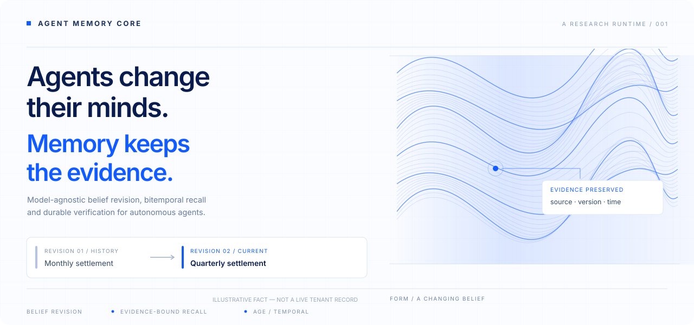

<div align="center">



# Agent Memory Core

### Make agent work survive correction, handoff, and interruption — without inventing proof.

**An API-first, local-first, evidence-aware memory runtime for AI agents.** Preserve versioned claims, provenance, bitemporal history, and durable task state through REST and Python SDK. **Verified Agent Work Continuity is experimental, not a claim of independently verified task completion.**

[](LICENSE)
[](pyproject.toml)
[](https://github.com/hippoley/Agent-Memory-Core-v0.1.0/actions/workflows/test.yml)
[](docs/USER-STORY-ACCEPTANCE.md)

[Quickstart](#quickstart) · [Evidence & status](#evidence-levels-and-product-boundaries) · [External reproduction](#independent-reproduction--external-integration) · [SDK](#connect-an-agent-with-the-python-sdk) · [Observatory](#memory-observatory--see-memory-not-just-messages) · [中文](docs/START-HERE.zh-CN.md)

</div>

---

## Why Agent Memory Core?

An agent remembers that a supplier is paid monthly. A newer contract changes
it to quarterly. Agent A disappears and Agent B resumes after an external
operation times out. A similarity search may retrieve both statements; it
doesn't answer which was valid, what Agent B is allowed to do, or whether the
external operation actually happened.

**AMC stores versioned, evidence-linked claims in canonical PostgreSQL, with
explicit correction, historical recall and recoverable projections.** Its
experimental work-continuity direction connects memory history to source-aware
handoff, durable effect state and independently checkable results.

| What needs to be decided | Existing or experimental boundary | Not yet proved |
|---|---|---|
| What did the system know, and when? | Canonical revision ledger and `valid_at`/`known_at` | Whether every source was truthful |
| Can Agent B safely resume? | Experimental freshness-checked handoff | Principal-bound delegation across all agents |
| Did the external call commit? | Fenced intent, `UNKNOWN` effect reconciliation | Exactly-once physical execution or causal independence |
| Can another team rely on this? | REST/SDK, test fixtures, experimental conformance | Non-author acceptance and adoption |

> **Models propose; PostgreSQL validates and commits. Indexed candidates are not
> authoritative facts. Recorded receipts are not automatically independent
> proof of physical effects.**

AMC complements LangGraph, Temporal, Mem0, PostgreSQL/pgvector and object stores.
It is not a new LLM, workflow engine or universal truth oracle. What AMC must
earn through tests—not marketing—is **verifiable continuation of work across
agent, model and storage boundaries**.

## Agent Work Continuity · experimental US-C01

**Make Agent Work Survive the Agent.** AMC now has a candidate continuity
contract that separates versioned memory, prepared context and durable task
state instead of making any one of them a replacement for Mem0, PowerContext
or Temporal.

Through the authenticated public API and Python SDK, an Agent A can generate
a bounded, source-linked `prepare_context` pack and freeze a `create_handoff`
receipt. A new Agent B client uses `accept_handoff` to revalidate the same
tenant, original claim IDs, task checkpoint and current external-effect state.
Stale, truncated or ambiguous handoffs return a conflict instead of success.
These operations **never** auto-run Provider effects.

**Current limitation:** Agent labels are descriptive, not independently
authenticated Agent principals; acceptance verifies a transferred snapshot,
not LLM comprehension or completion. A full independently reproducible
Agent-B task continuation, comparative benchmark and external human release
gate are still required before a 9.5/10 product claim.

[US-C01 contract and boundaries](docs/AGENT-WORK-CONTINUITY-US-C01.md) ·
[Two-session SDK example](examples/us_c01_agent_handoff.py)

## What you can build

| Use case | What the runtime provides |
|---|---|
| Personal or workspace memory | Durable claims, current recall and historical versions |
| Agent correction | Explicit revision with source linkage and idempotency |
| Evidence-grounded answers | Provenance lookup and binary evidence objects |
| Hybrid retrieval | PostgreSQL full-text search, optional pgvector and Apache AGE |
| Long-running verification | Events, workflow status and optional Temporal workers |
| Multiple independent agents | Public REST API, Python SDK and tenant-scoped credentials |

This is a memory component for your existing agent stack — not a replacement for LangGraph, AgentScope, an LLM, or your application.

## Evidence levels and product boundaries

| Level | What it would mean | Publicly verified status |
|---|---|---|
| **SOURCE** | Source code is inspectable | Core memory API, revisioned PostgreSQL, bitemporal recall and optional projections are present in `main` |
| **CI** | Specific tests passed on a **specific SHA** | See [GitHub Actions](https://github.com/hippoley/Agent-Memory-Core-v0.1.0/actions); green CI is not third-party acceptance |
| **LIVE** | External provider, independently observed real outcome | Not yet established for the full handoff / three-cloud stories |
| **INDEPENDENT** | Non-author completes the documented public-main journey | [Independent cold-install #57](https://github.com/hippoley/Agent-Memory-Core-v0.1.0/issues/57) remains open |
| **ADOPTED** | External code pins and depends on an AMC interface or verifier | Not yet demonstrated; [external conformance reproduction #70](https://github.com/hippoley/Agent-Memory-Core-v0.1.0/issues/70) remains open |

| Surface | Availability |
|---|---|
| Local REST, SDK, fact revision, history, browser demo | Published **`main`**; use the Quickstart below |
| Agent handoff | [Experimental US-C01](docs/AGENT-WORK-CONTINUITY-US-C01.md); principal-bound delegation and complete effect evidence are not accepted |
| Offline continuity conformance (12 failure/control vectors) | [PR #69](https://github.com/hippoley/Agent-Memory-Core-v0.1.0/pull/69) **unmerged**; not available on main |
| AWS + Alibaba + Azure retrieval adapters | [PR #71](https://github.com/hippoley/Agent-Memory-Core-v0.1.0/pull/71) **Draft/unmerged**, opt-in candidate reads; no complete durable remote Outbox or live-cloud acceptance |
| Verified Agent-B terminal task outcome | [Issue #68](https://github.com/hippoley/Agent-Memory-Core-v0.1.0/issues/68) open; [source-revocation gap #67](https://github.com/hippoley/Agent-Memory-Core-v0.1.0/issues/67) open |

Do not combine successful jobs from different SHAs into a release verdict.
For unproven observations, **UNKNOWN is a valid and necessary outcome**.

## Quickstart

The supported public installation source is **`main`**, not an unmerged feature branch. Docker Compose and Python are required; no hosted AMC account is needed. The local demo is on published `main`. Automated CI cold-start checks exist, but unassisted external human acceptance [#57](https://github.com/hippoley/Agent-Memory-Core-v0.1.0/issues/57) is still open. Record your exact `git rev-parse HEAD` when reproducing.

**Prerequisites:** Git, Docker Compose v2, Python 3.10+.

### 1. Start the runtime

```bash
git clone --branch main --single-branch https://github.com/hippoley/Agent-Memory-Core-v0.1.0.git
cd Agent-Memory-Core-v0.1.0
git branch --show-current # must print main

# Fast local memory + API profile
python scripts/launch_local.py up --profile lite
```

For the integrated identity, browser login and Temporal development flow:

```bash
python scripts/launch_local.py down
python scripts/launch_local.py up --profile extended --identity
```

The launcher provisions the local services and writes development configuration to the ignored `.env.local`. Wait for the stack to become healthy before opening the UI.

### 2. Open the interfaces

| Interface | Local URL | Purpose |
|---|---|---|
| Console | [127.0.0.1:8765/dashboard/](http://127.0.0.1:8765/dashboard/) | Browse and search memory |
| Observatory | [127.0.0.1:8765/dashboard/observatory.html](http://127.0.0.1:8765/dashboard/observatory.html) | Inspect memory and evidence |
| API manual | [127.0.0.1:8765/docs](http://127.0.0.1:8765/docs) | Runnable API examples |
| Swagger UI | [127.0.0.1:8765/docs/swagger](http://127.0.0.1:8765/docs/swagger) | Explore HTTP operations |
| OpenAPI | [127.0.0.1:8765/openapi.json](http://127.0.0.1:8765/openapi.json) | Machine-readable contract |

The local development API key is generated into `.env.local`. Use the identity-enabled profile and sign in through the configured local OIDC provider when testing multi-user workspaces and scoped API credentials.

### 3. Make your first SDK call

Install the project in a virtual environment:

```bash
python -m venv .venv
# macOS / Linux
source .venv/bin/activate
# Windows PowerShell: .venv\Scripts\Activate.ps1

python -m pip install -e '.[api,postgres]'
```

### 4. Verify the running product end to end

This is an actual API/SDK smoke journey, not a CI status check. It creates a uniquely named memory, revises it, verifies current recall and retained history, calls search, reads evidence and events, and exits non-zero on the first broken product operation:

```bash
python scripts/smoke_local.py
```

A successful run ends with `LOCAL_MEMORY_RUNTIME_ACCEPTED`. It first authenticates the PostgreSQL readiness probe, then exercises the object-store upload/download round-trip, binds the evidence digest to a claim, revises that claim, and verifies current recall, retained history, search, provenance and events. It talks only to the local HTTP API through the public SDK; it does not connect to PostgreSQL directly. It leaves uniquely named demo records in the local database so they can be inspected in Observatory.

For durable local Temporal execution (separate server + Worker, Workflow History retained in a named Docker volume across container replacement), use the extended profile:

```bash
python scripts/launch_local.py up --profile extended
```

See [Temporal Durable Execution and Recovery](docs/TEMPORAL-DURABLE-EXECUTION.md) for restart, backup, restore boundaries and the exact distinction between Workflow replay and resuming an interrupted Activity.

Then connect to the local API using the development key from `.env.local`:

```python
from pathlib import Path
from datetime import datetime, timezone
from agent_memory_core.sdk import MemoryClient

# The local launcher saves credentials in .env.local; it does not export
# them to your terminal. Read the locally generated key without printing it.
settings = dict(
    line.split("=", 1) for line in Path(".env.local").read_text(encoding="utf-8").splitlines()
    if "=" in line and not line.lstrip().startswith("#")
)
with MemoryClient(
    "http://127.0.0.1:8765",
    settings["MEMORY_API_KEY"].strip(),
    tenant_id=settings["MEMORY_TENANT_ID"].strip(),
) as memory:
    claim = memory.remember(
        subject_id="supplier-a",
        predicate="settlement_period",
        value={"period": "monthly"},
        source_id="contract:version-1",
        valid_from=datetime.now(timezone.utc).isoformat(),
        idempotency_key="supplier-a:settlement:v1",
    )

    print("Current:", memory.recall("supplier-a"))
    print("History:", memory.list_memories(
        subject_id="supplier-a",
        include_superseded=True,
    ))
```

The local single-key configuration is a convenient development/legacy mode. For independent agents and multi-user identity, use a tenant-scoped API credential as described below.

To stop the local stack:

```bash
python scripts/launch_local.py down
```

## Run the product locally in a browser

Use the published mainline browser walkthrough. If the script is unexpectedly absent from the exact `main` checkout, report the SHA and failure rather than switching to an unmerged PR.

```bash
git clone --branch main --single-branch https://github.com/hippoley/Agent-Memory-Core-v0.1.0.git
cd Agent-Memory-Core-v0.1.0
python -m pip install -e '.[api,postgres]'
python scripts/demo_local.py
```

The launcher starts the loopback-only Docker Compose stack, runs a real SDK lifecycle (create → revise → current/history readback → search → evidence object round-trip → events), and runs the existing seven-turn Chinese demo-story seeder through the public text-processing API (without invoking its optional cleanup mode), then opens the Console, Observatory and API manual in your browser. Smoke and demo records remain in the local database for inspection. The seeder prints the actual extraction relations; unextracted utterances are not presented as successful memories. Lite defaults to the local `rule` extractor, so this is a UI/API walkthrough, not evidence of LLM quality. It does not call a hosted model or publish the API to the Internet.

- **Console:** `http://127.0.0.1:8765/dashboard/` — natural-language ingestion, claim ledger, history and search.
- **Observatory:** `http://127.0.0.1:8765/dashboard/observatory.html` — start in clearly labeled synthetic Demo mode, then connect with the local key to inspect Live API data.
- **API manual:** `http://127.0.0.1:8765/docs`.

The key is generated locally in `.env.local` as `MEMORY_API_KEY`; paste it only into the local browser page. Stop the stack with `python scripts/launch_local.py down`. See [the Chinese local demo guide](docs/LOCAL-DEMO.zh-CN.md) for profiles, identity mode and safety boundaries.

## Verify installation, persistence, and troubleshooting

The commands above are for a **local development instance**. Use the **Lite** profile for the first installation; `extended --identity` is a separate development scenario, not a prerequisite for the basic demo.

After `python scripts/demo_local.py`, look for **both** `LOCAL_MEMORY_RUNTIME_ACCEPTED` and `AGENT_MEMORY_CORE_LOCAL_DEMO_READY`. Verify the application and authenticated PostgreSQL readiness:

```bash
python scripts/launch_local.py status
# Expected: PRODUCT STATUS: READY
```

Open the Console and Observatory URLs printed by the launcher. Find `MEMORY_API_KEY` in the private, generated `.env.local` and enter it **only in the local UI** when asked. Observatory starts in **synthetic Demo** mode: explicitly switch to **Live** to inspect and change real API records. In Live, create a fact, revise it, inspect history, and soft-forget its new version; do not treat an API write acknowledgment without canonical readback as proven success.

To verify that a restart does not erase data, use the included **two-phase public-SDK acceptance probe**. It first writes one uniquely identified fact, revises it, verifies both versions, and saves a local **non-secret** receipt at `.demo/restart-persistence.json` (ignored by Git). Run these commands from the repository root in order:

```bash
python scripts/check_restart_persistence.py capture
# Expected: RESTART_BASELINE_CAPTURED
python scripts/launch_local.py down
python scripts/launch_local.py up --profile lite
python scripts/launch_local.py status
# Expected: PRODUCT STATUS: READY
python scripts/check_restart_persistence.py verify
# Expected: RESTART_PERSISTENCE_ACCEPTED
```

The `verify` command independently reconnects to the restarted HTTP API through the public Python SDK. It asserts that the exact original and revised memory IDs survive, the revised fact remains current, the original is still in retained history with `superseded_at`, and both values are unchanged. It also checks Docker Compose container identities for **both `memory-api` and `memory-db`**: the two IDs must differ from the pre-restart receipt. Simply running `capture` followed by `verify` without a real Compose restart now fails closed. This validates instance replacement, not backup/restore or host-machine reboot. A failed/missing readback returns a **nonzero exit status** and prints `RESTART_PERSISTENCE_FAILED`. It never queries PostgreSQL directly or reads the UI's in-memory state. Do **not** run `docker compose down -v`, erase volumes or remove `.env.local` between phases. A receipt can be checked again using `verify`; to start a *new* baseline, archive or delete only the non-secret `.demo/restart-persistence.json` once prior evidence is recorded.

This validates persistent local memory history over a real container restart, not independent human onboarding, production backup/restore, Temporal crash recovery, or external source trust.

### If installation or startup fails

- `git branch --show-current` must print `main`; confirm `scripts/demo_local.py` exists before running it.
- Make sure the Docker daemon is running (`docker info`) and Compose v2 is available (`docker compose version`). Confirm `python --version` reports Python 3.10 or newer.
- A local port collision on `8765`, or unavailable Docker image downloads, can prevent startup. Record the actual error; do not expose services on a public interface as a workaround.
- Run `python scripts/launch_local.py status` to check service health and authenticated database readiness. For the default Lite stack, inspect logs using the same Compose file set as the launcher:

```bash
docker compose --env-file .env.local -f compose.yaml -f compose.app.yaml ps
docker compose --env-file .env.local -f compose.yaml -f compose.app.yaml logs --tail=150
```

- `.env.local` is generated on first successful setup. Never upload its contents, bearer tokens, database passwords, or unredacted logs to GitHub issues. If reporting a failure in [P0-1 external acceptance](https://github.com/hippoley/Agent-Memory-Core-v0.1.0/issues/57), include OS, Python/Docker versions, `main` commit SHA, exact failing command, redacted error and whether Live mode was reached.
- The local development profile is **not** a production security deployment. For identity and Temporal, use `python scripts/launch_local.py up --profile extended --identity` and the linked specialized guides; do not expose the development admin credentials or bind the local API to the Internet.

## Connect an agent with the Python SDK

External agents use the same public REST API as Observatory. They do not import server modules, access PostgreSQL, or use browser-only business endpoints.

### Install

The SDK is not yet published to PyPI. Install from the public `main` branch; do not use a historical integration branch:

```bash
python -m pip install 'agent-memory-core[api] @ git+https://github.com/hippoley/Agent-Memory-Core-v0.1.0.git@main'
```

When a versioned PyPI release is published, the installation command will move to the versioned package. Do not assume `agent-memory-core==0.1.0` on PyPI is this repository's distribution.

### Issue a tenant-scoped credential

1. Sign in to an identity-enabled deployment using its configured OIDC provider.
2. Open the intended Workspace as an Owner or Admin.
3. Create an API credential with the required scopes (normally `memory:read` and `memory:write`) and an expiry.
4. Copy the returned secret immediately. It is shown once; the server stores its hash.
5. Keep the secret in an environment variable or secret manager — never commit it or embed it in frontend code.

An API credential cannot mint another credential. Credential issuance and revocation require an authenticated Owner/Admin browser Session and CSRF protection. See the [API reference](docs/API-REFERENCE.md) for the exact HTTP contract.

### Run the independent consumer example

The repository includes a separately installable consumer project:

[`examples/third_party_memory_agent`](examples/third_party_memory_agent/README.md)

It imports only `agent_memory_core.sdk.MemoryClient` and exercises readiness, identity, capabilities, create, revise, current/history readback, search, provenance, events, optional Temporal verification, forget and retained-history verification.

Configure it with:

```bash
export MEMORY_BASE_URL='http://127.0.0.1:8765'
export MEMORY_TENANT_ID='your-workspace-id'
export MEMORY_API_KEY='your-once-issued-credential'
python -m pip install ./examples/third_party_memory_agent
python -m third_party_memory_agent
```

For Temporal verification, set `MEMORY_RUN_TEMPORAL=1` only when the deployment advertises the Temporal capability and its worker is running.

The independent consumer has completed its real API lifecycle in the PR #51 Product E2E environment, including loading the SDK from the clean virtual environment's `site-packages`. The broader Product E2E job also contains a queued-work revocation check; its latest executor fix is awaiting a fresh run. See [PR #51](https://github.com/hippoley/Agent-Memory-Core-v0.1.0/pull/51) for current evidence. This is not a claim that the full release gate or production deployment is complete.

## Memory Observatory — See memory, not just messages

**Memory Observatory** is the visual inspection surface for the memory runtime: browse claims, inspect provenance, filter the records currently loaded, and follow durable events.

- [Open the Observatory source](src/agent_memory_core/resources/dashboard/observatory.html)
- [Open the interactive Memory Atlas](docs/demo/index.html) — a local, credential-free conceptual walkthrough using illustrative data.
- [Design system and visual semantics](docs/DESIGN-SYSTEM.md)
- [Architecture review and trust boundaries](docs/ARCHITECTURE-REVIEW.md)

The Observatory work originated in **PR #30**; the API-first identity and third-party integration work continues in **PR #51**. Local Chromium acceptance passed on 2026-11-18 for the documented browser path. This does not mean a public hosted service exists: **no public hosted deployment is claimed**. The Atlas is explanatory and synthetic; it is not a live tenant dashboard or a screenshot of production data.

To inspect the UI locally, start the stack and open `http://127.0.0.1:8765/dashboard/observatory.html`. For a credential-free public preview, use the committed [Memory Atlas](docs/demo/index.html). For a local authenticated API walkthrough, replace the placeholder below with the key generated in your own ignored `.env.local` file; never paste a real key into README or commit it:

```bash
export MEMORY_API_KEY='YOUR_LOCAL_API_KEY'
curl http://127.0.0.1:8765/v1/ready \
  -H "Authorization: Bearer $MEMORY_API_KEY"
```

The current visual preview does not yet guarantee complete-tenant visualization, graph-edge truth, or production authorization semantics. See [the architecture review](docs/ARCHITECTURE-REVIEW.md) for the explicit boundaries.

## API and observability

The REST API is the product boundary. OpenAPI is the interface contract; the Python SDK is a client, not a second implementation of business logic.

- [API reference and third-party integration](docs/API-REFERENCE.md)
- [API-first product contract](docs/API-FIRST-PRODUCT-CONTRACT.md)
- [Swagger guide (中文)](docs/SWAGGER_GUIDE.zh-CN.md)
- Runtime OpenAPI: `/openapi.json`
- Runtime API manual: `/docs`
- Runtime Swagger UI: `/docs/swagger`

Useful operations include:

| Capability | SDK method | API behavior |
|---|---|---|
| Identity | `whoami()`, `workspaces()` | Read authenticated identity and workspaces |
| Create / revise | `remember()`, `revise()` | Commit canonical versioned claims |
| Current / history | `recall()`, `list_memories()` | Read active state and superseded versions |
| Search | `search()` | SQL plus enabled retrieval channels |
| Evidence | `sources()`, `upload_object()`, `download_object()` | Read provenance and evidence objects |
| Events | `events()` | Read durable event history |
| Async verification | `verify_memory_async()`, `workflow_status()` | Start and inspect Temporal verification |
| Workflow control | `cancel_workflow()` | Request cancellation |
| Webhooks | SDK webhook methods | Configure and operate event delivery |

Check `GET /v1/capabilities` before using optional vector, graph, object-storage or Temporal features. The API returns the actual availability of each capability.

## Architecture


**One canonical authority, multiple retrieval views.** PostgreSQL owns committed claims and revision history. Full-text, vector and graph indexes help discover candidates; they do not override canonical tenant and time eligibility.

```text
Any agent / REST / Python SDK
             |
       Public API + identity
             |
    Candidate + evidence checks
             |
    Deterministic revision guard
             |
 PostgreSQL — canonical claims, provenance,
      bitemporal history and outbox
       |             |             |
      FTS          pgvector    Apache AGE
       \____________|____________/
                    |
          Canonical-filtered recall
                    |
             Agent / consumer

     Temporal — optional durable verification
```

### Core lifecycle

1. **Capture:** associate a candidate with a source and tenant.
2. **Validate:** check identity, scope, policy and revision preconditions.
3. **Commit:** persist the canonical claim and history transactionally.
4. **Project:** update retrieval views through recoverable asynchronous work.
5. **Recall:** retrieve candidates, then filter against canonical state and bitemporal rules.
6. **Verify:** optionally run durable Temporal workflows and preserve verification receipts.

## Deployment profiles

| Profile | PostgreSQL | Vector / AGE retrieval | Projection worker | Temporal |
|---|---|---|---|---|
| Lite | Yes | Off | No | No |
| Standard | Yes | On when providers/extensions are configured | No | No |
| Full | Yes | On when providers/extensions are configured | Yes | No |
| Extended | Yes | On when configured | Yes | Local development server + verification worker |

Start a profile with `python scripts/launch_local.py up --profile <lite|standard|full|extended>`. Add `--identity` to enable the local identity/OIDC development stack. Extended is intended for integrated development and acceptance, not a production Temporal operations recipe.

Lite still uses the PostgreSQL database image; it is not SQLite-only or a measured low-memory guarantee. See [runtime profiles and limitations](docs/LIGHTWEIGHT-RUNTIME.md).

## Durable Task Worker Runtime (merged foundation; release gates remain)

The PostgreSQL task store now has an independent worker runtime with
lease/heartbeat renewal, epoch-fenced checkpoint commits and process-level
recovery. Worker credentials require the explicit `tasks:execute` scope;
ordinary memory write credentials cannot claim or mutate durable tasks.

- [Standalone worker handler example](examples/durable_task_worker/README.md)
- [API and worker authorization contract](docs/API-REFERENCE.md)
- Runtime entrypoint: `python -m agent_memory_core.worker_runtime`

The SIGKILL acceptance test starts Worker A as a separate OS process, kills it
after a durable checkpoint, then starts Worker B to reclaim the expired lease
and resume from that checkpoint. The test passed in the PostgreSQL integration workflow on HEAD
`3e1bce2db53e074baf0c7ba8d3755cc02b67341f`. The integration workflow
reported 62 passed and 7 skipped; skipped tests are not counted as passing. Provider-side idempotency and
UNKNOWN reconciliation remain separate release gates; a database lease does
not make a remote side effect exactly once.


## External effect safety (Migration 008)

Durable checkpoints can record external effect intents transactionally.
`agent_memory_core.durable_effects` adds fenced provider execution and
UNKNOWN reconciliation. An expired Worker does not trigger an automatic
provider retry: the replacement Worker first reconciles the prior idempotency
key. Only a definitive provider `NOT_FOUND` returns the effect to
`requested`; task completion is blocked until every effect is committed.

Provider adapters must implement `execute(request, idempotency_key)` and
`reconcile(request, idempotency_key, provider_reference)`. The stable key
is scoped to tenant + task + effect. Exactly-once remote execution is not
claimed; it depends on provider-side idempotency and reconciliation semantics.


The fencing boundary is enforced inside the canonical Python task store too:
checkpoint and status mutations require the current Worker ID and Lease Epoch.
The HTTP layer is not the only guard; a tenant-only SDK/store write cannot
bypass the PostgreSQL lease check.

## What is implemented — and what is not

### Working foundations

- Public REST API and OpenAPI contract for core memory operations.
- Python SDK for identity-aware API access, memory lifecycle, search, evidence, events and workflow operations.
- PostgreSQL canonical claims, provenance, revision history and outbox.
- A **separately runnable consumer example** exercised by this project's integration tests; this is **not evidence of adoption by an unrelated maintainer**.
- Local Observatory and browser-based OIDC integration.
- Optional pgvector, Apache AGE and Temporal integration paths.

### Still being productized

- Independently verified **non-author** clean-machine installation and Owner bootstrap ([#57](https://github.com/hippoley/Agent-Memory-Core-v0.1.0/issues/57)); project-owned automated cold-start tests already exist.
- Production-ready shared multi-tenant worker routing and complete worker authorization across every projection.
- Independent public-TLS Webhook receiver, credential rotation and receiver-side idempotency/replay evidence; internal delivery/DLQ mechanisms already exist.
- Complete process/DB restoration, external-effect reconciliation and independently verified backup/restore for supported deployment modes; narrower process-level tests exist.
- Invitation onboarding, full membership administration and complete resource-level RBAC.
- External OIDC provider compatibility, production secret rotation, rate limiting, TLS deployment hardening and independent security review.
- Cross-domain model extraction/retrieval quality and measured load/latency/recovery targets.

The repository is active development software. It does not yet guarantee production-grade multi-tenant isolation or operational recovery. It is not yet a hosted public SaaS or a security-reviewed multi-tenant production service. Do not expose the local development stack directly to the Internet or put regulated/production secrets into a demo deployment.

## Evaluation and engineering evidence

The repository preserves fixed Chinese extraction and multi-turn evaluation sets. The [200-case rule-extractor replay](data/eval/ZH-200-RULE-REPLAY-20261116.md) measured **94.34% extraction F1** on its stated in-scope A/B/C examples; this is not end-to-end memory quality, real-model quality or a general benchmark. Out-of-vocabulary exact coverage was 0/30.

Run the basic test suite:

```bash
python -m pip install -e '.[dev,postgres,api]'
pytest -q
```

For integration tests, use a disposable PostgreSQL / pgvector / AGE environment and set `MEMORY_TEST_DSN` as described in the [acceptance guide](docs/USER-STORY-ACCEPTANCE.md).

## Independent reproduction & external integration

The best contribution is a small **reproducible failure or independent implementation**,
not another architecture diagram. Include OS, Python/Docker versions, exact
`git rev-parse HEAD`, commands, exit code, expected/observed state, and
redacted evidence; never publish credentials or personal data. Use the
[third-party reproduction record](docs/EXTERNAL-REPRODUCTION-RECORD.md) for a concise, auditable issue report.

1. **Released product:** clone public `main`, run the [local guide](docs/LOCAL-DEMO.zh-CN.md), and independently verify create → revise → historical read → forget → restart. Record failures or a non-author acceptance result in [#57](https://github.com/hippoley/Agent-Memory-Core-v0.1.0/issues/57).
2. **Portable, offline task/effect consistency (experimental):** [PR #69](https://github.com/hippoley/Agent-Memory-Core-v0.1.0/pull/69) has a pinned 12-vector stdlib-only verifier, intentionally **not in `main` yet**. Check out that PR's explicitly documented SHA and run `python -I -S tools/run_continuity_vectors.py`. Its PASS is only consistency of *caller-supplied, untrusted JSON*, **not** authentication, source validity or evidence of physical execution. Share independent runs or compatible implementations via [#70](https://github.com/hippoley/Agent-Memory-Core-v0.1.0/issues/70).
3. **Real effect safety:** submit a deterministic source-revocation-before-intent test to [#67](https://github.com/hippoley/Agent-Memory-Core-v0.1.0/issues/67), or review the independent task terminal-state acceptance contract in [#68](https://github.com/hippoley/Agent-Memory-Core-v0.1.0/issues/68).
4. **Multi-cloud correctness (experimental):** review [#71](https://github.com/hippoley/Agent-Memory-Core-v0.1.0/pull/71); SDK simulations and local PostgreSQL tests must not be presented as real AWS/Alibaba/Azure cloud acceptance.

**What counts as a third-party dependency?** A non-author project referencing a pinned
artifact in its own code/CI, publishing a minimal failing case, or shipping an
independently implemented compatible verifier. Stars, author-run tests, and
unreviewed endorsements do not count.

**Prior art:** [LangGraph checkpointing](https://github.com/langchain-ai/langgraph),
[Agent Memory Continuity Protocol](https://github.com/nunchi-ai/amcp) and
other handoff systems already cover adjacent problems. AMC does not claim
to invent persistence or agent-to-agent state transfer; evaluate this work
on independently testable **revision, source authority, UNKNOWN effects,
and terminal continuity semantics**.

## Contributing

The most valuable contributions are reproducible improvements to the public product path:

- A third-party SDK call that fails against the documented API.
- A revision that leaves stale state active or loses provenance.
- A tenant boundary or revoked identity that can still perform an operation.
- A worker crash/retry that loses or duplicates a durable side effect.
- A clean deployment or restore procedure that another developer cannot reproduce.
- A retrieval evaluation with a frozen dataset and honest metrics.

See [CONTRIBUTING](CONTRIBUTING.md), [SECURITY](SECURITY.md), [User Story acceptance](docs/USER-STORY-ACCEPTANCE.md), and the [engineering roadmap](docs/AGE-TEMPORAL-STRATEGY.md).


---

<div align="center">

**Memory shouldn't just survive a session. It should survive being wrong.**

[中文导览](docs/START-HERE.zh-CN.md) · [Interactive Atlas](docs/demo/index.html) · [API reference](docs/API-REFERENCE.md) · [Report an issue](https://github.com/hippoley/Agent-Memory-Core-v0.1.0/issues)

</div>
