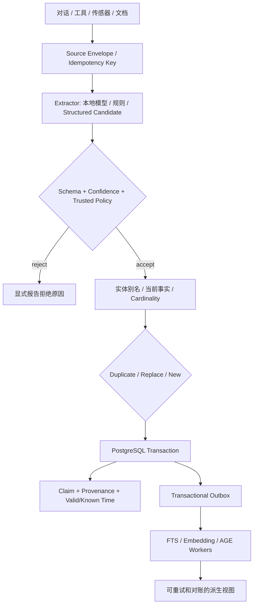
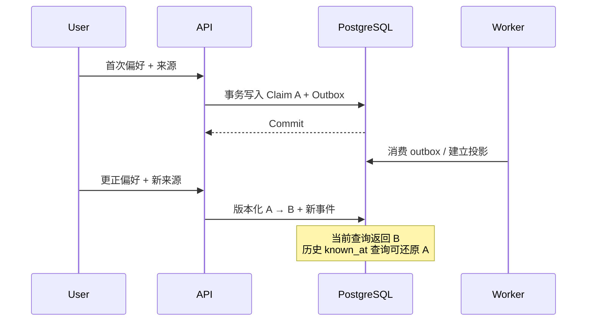
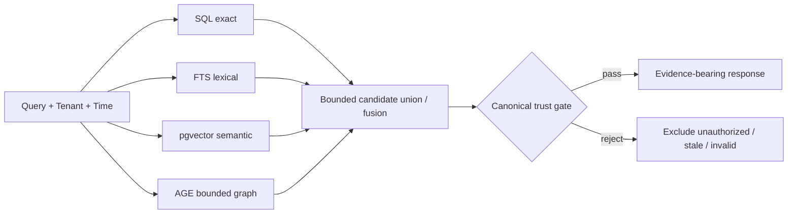
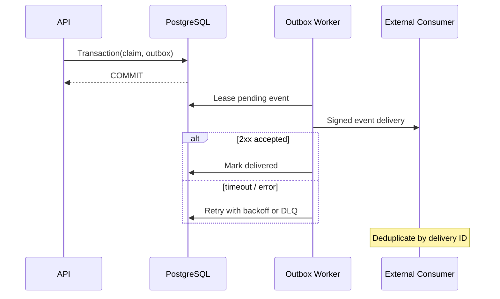

# Agent Memory Core — 原理与架构剖析

> 与 [Memory Atlas 交互页面](demo/index.html) 配套的工程级说明。本文区分 **设计原则**、**当前代码可执行路径** 与 **尚未通过的发布门槛**。不把交互模拟当成真实推理或性能测试。

## 0. 这个系统要解决什么问题？

普通对话上下文是一个不断增长、随后被截断的 token 序列。但 Agent 跨会话、跨工具、跨设备工作时，需要回答五个更严格的问题：

- **知道什么**：结构化事实，而不是只保存聊天全文。
- **凭什么知道**：哪条对话、工具观测、文件或设备提供了证据。
- **什么时候成立**：事实对现实世界有效的时间 `valid_at`。
- **什么时候知道**：系统在什么时间收到或修正了知识 `known_at`。
- **还该不该相信**：被纠正、撤销、过期或无权访问的候选不能作为当前依据。

由此，记忆是一个带版本、来源、策略、事件和检索投影的 **canonical facts system**，不是一张 embedding 表。

## 1. 写入路径：一个候选如何升级成事实

**关键边界：**

1. Extractor 只提出 `subject_id` / `predicate` / `value` / `confidence`；它不能自行设定可信 `one/many` 谓词策略。
2. 同一事实重复出现时，应该链接新证据，而不是重复创建 canonical claim。不同值在单值策略下应遵循显式替换/冲突约束。
3. Canonical claim 和 outbox 必须共享 PostgreSQL 提交边界；工作进程失败后能从可靠事件记录恢复。
4. Embedding/AGE 失败只能影响可选查询通道；不能把已经提交的权威事实回滚成“从未发生”。
5. 当前提供规则和可配置 provider；真实中文口语抽取质量尚需人工裁定语料评测，不能从 `/process` 返回 200 推断正确率。

相关实现：`src/agent_memory_core/processing.py`、`postgres.py`、`api.py`、`projection_worker.py`；审计入口 `tests/test_processing_concurrency.py` 与 `tests/test_user_story_e2e.py`。

## 2. 双时间的本质：世界何时改变，系统何时得知

假设 10:00 用户告诉 Agent：“卧室晚上保持安静。” 10:20 用户更正：“晚上可以播放轻音乐。”

| 事实 | `valid_at`（现实有效时间） | `known_at`（数据库获知时间） | 当前可用？ |
|---|---|---|---|
| `noise=quiet` | 初次偏好开始时 | 10:00 写入 | 更正后不应作为当前单值事实 |
| `noise=soft_music` | 用户指定的更正生效时 | 10:20 写入 | 在适用时间、策略和权限下可用 |

`valid_at` 回答“在目标现实时间，什么说法成立”；`known_at` 回答“在某个历史系统时间，系统当时知道什么”。它们不能互相替代。此表为概念例子，不意味着更正文本能自动推断精确生效时间。

**尚需的验证：** 极端回填、复杂生效区间拆分以及真实语言中的否定、指代、歧义，需要单独测量，不应由最简单的“写入-纠正”案例推导其正确性。

## 3. 为什么 PostgreSQL / pgvector / Apache AGE 不重复？

| 层 | 主要角色 | 能否单独裁定真实性 | 故障处理 |
|---|---|---|---|
| PostgreSQL claims + provenance | 可信事实、租户、授权、时间、持久事件 | **唯一权威来源** | 事务与备份恢复 |
| PostgreSQL FTS | 精确关键词 / 名称候选 | 否 | 重建索引 |
| pgvector | 语义近邻候选 | 否 | 重算 embeddings / 索引 |
| Apache AGE | 实体关系与有限跳数路径候选 | 否 | 从 SQL edge 重投影、对账 |
| ObjectStore | 原始证据字节，SHA-256 寻址 | 否，SQL 元数据决定可见性 | 校验、孤儿引用对账 |
| Temporal（可选） | 长周期、重试、等待、补偿的流程编排 | 否 | Workflow history + Activities |
| Outbox / SSE / Webhooks | 提交后传播、订阅、重放 | 否 | cursor、幂等、重投、死信 |

因此不是部署三种独立数据库，而是在单个兼容 PostgreSQL 环境中组合 canonical facts、pgvector 和 AGE。真实生产配置需固定兼容的 Postgres/扩展版本并测试。

## 4. 混合召回：先发现，再证伪

- SQL exact：按主体、谓词、租户和时间过滤。
- FTS：弥补纯向量对型号、符号、字面词的不稳定。
- pgvector：发现不同表达但语义相近的内容；向量 profile/维度必须相容。
- AGE：有限跳数关联检索，帮助发现“卧室 → 窗户 → 传感器”一类上下文。
- Candidate fusion 之后仍需要 canonical recheck；**相似度高不等于有权限，更不等于当前事实正确。**
- 当某个可选通道不可用时，应该显式反映 `channels_used` / capability，而不是悄悄声称全能力正常。

这些是架构意图和现有实现机制的解读，不保证中文语义检索已经达到给定指标。参考 `docs/USER-STORY-ACCEPTANCE.md` 的真实评测门槛。

## 5. 事件不是“把 WebSocket 加上去”

写入事务产生 durable outbox。消费者持久记录投递进度，失败时有限重试，超限后进入死信并可受控重放。SSE 用于浏览器订阅和断线续接；webhook 适用于远端系统，接收端必须做幂等处理。

这套设计重点是 **已确认写入不被通知失败吞掉**，而不是承诺零延迟。真实公网 webhook/证书轮换/进程故障恢复另有验收门槛。

## 6. 开发者如何确认不是概念展示

| 操作 | 入口 | 核验结果 |
|---|---|---|
| 查询运行能力 | `GET /v1/capabilities` | 观察 graph/vector/extractor 等可选通道 |
| 查看接口契约 | `/openapi.json` | 生成的 OpenAPI 数据 |
| 用 Swagger 试 API | `/docs/swagger` | 使用独立、私密的授权密钥 |
| 执行写入和证据读取 | `POST /v1/memories`, `GET /v1/memories/{memory_id}/sources` | claim + provenance |
| 读历史事实 | `GET /v1/memories?known_at=...` | 已版本化事实的历史可见性 |
| 事件重放 | `GET /v1/events` | cursor、事件及重连行为 |
| 运行真实 DB 集成测试 | `pytest -q -m integration` | 按执行 SHA 审核无 skip 的证据 |

具体 API 参数请使用实际部署实例生成的 OpenAPI，而非仅复制本页概念示例。

## 7. 下一轮真正的 Release Gate

- **抽取真实质量**：至少 200 条人工裁定中文样本；事实 micro-F1 ≥ 0.90，纠正准确率 ≥ 0.95。
- **检索真实质量**：至少 200 条有标准答案的中文查询；Recall@5 ≥ 0.90，MRR@10 ≥ 0.85。
- **灾难/恢复**：杀进程、重启数据库、回放积压、备份恢复，提交确认后的数据不得丢失。
- **安全**：数据库层 tenant/RLS、密钥管理、授权边界和公网暴露的威胁模型独立核验。
- **操作体验**：公开静态演示与私有真实 Console 分开部署，公开访客不得接触 bearer 密钥。

这些是目标阈值，不是当前已通过的实际成绩。最新进度以 [User Story Acceptance](USER-STORY-ACCEPTANCE.md) 和仓库同 SHA 的 CI/评测记录为准。

---

**阅读路径：** [互动演示](demo/index.html) → 本篇原理 → [API Reference](API-REFERENCE.md) → [Swagger 中文指南](SWAGGER_GUIDE.zh-CN.md) → [验收门槛](USER-STORY-ACCEPTANCE.md)。
