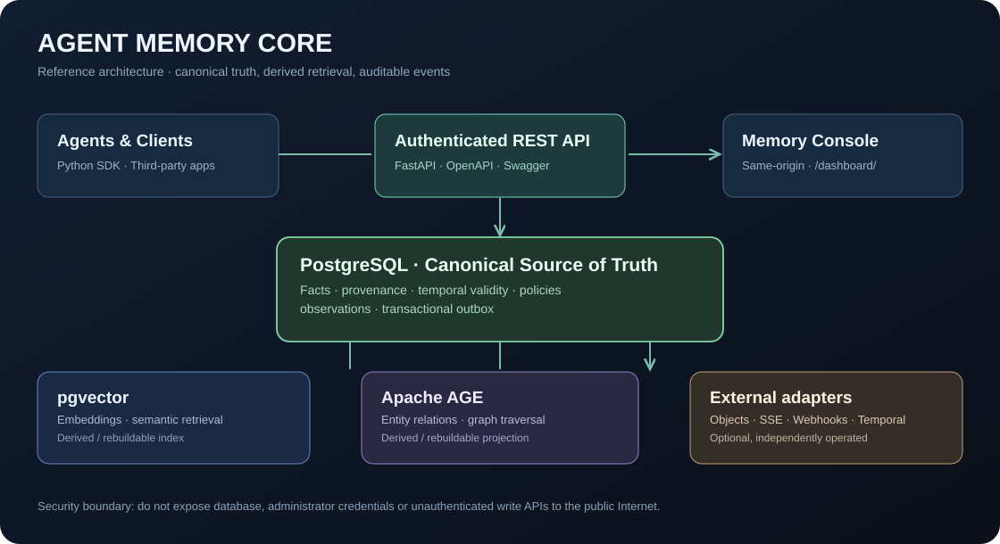

# Public-facing product demo and API deployment

This repository has **two different browser experiences**. They have different trust boundaries.

| Surface | URL after deployment | Data | Authentication |
|---|---|---|---|
| Static interactive product tour | `/demo/` on GitHub Pages (see below) | Synthetic browser-only data | None |
| Real Memory Console | `/dashboard/` on the API host | Real tenant facts | The page is public, API actions require bearer key |
| API manual | `/docs` on the API host | Live OpenAPI contract | Public docs; requests must authenticate |
| Swagger UI | `/docs/swagger` on the API host | Live OpenAPI contract | Public docs; requests must authenticate |
| OpenAPI JSON | `/openapi.json` on the API host | API definitions | Public schema |

> The static page is a visual simulation, not a backed service or a claim of successful real-model extraction. The existing `/dashboard/` is the actual API-backed browser console.

## A. Publish the no-credentials interactive demo

The file is `docs/demo/index.html`. GitHub Pages can publish the `docs/` directory on `main`. This requires a repository administrator to enable Pages in **Settings → Pages → Build and deployment → Deploy from a branch → main /docs → Save**.

After Pages deployment succeeds, the expected URL is:

`https://hippoley.github.io/Agent-Memory-Core-v0.1.0/demo/`

**Do not present this expected address as verified online until the GitHub Pages deployment finishes and an external HTTP check succeeds.**

The demo is self-contained and sends no request to the memory API. It does not request secrets and uses synthetic node data. Refreshing clears the in-browser simulated facts.

## B. Expose a real API-backed console safely

The current project is an **experimental single-tenant-per-process** reference implementation. Exposing it as a multi-tenant production SaaS is not supported by this guide.

For a private team pilot, provide your own VM with Docker, TLS reverse proxy, tenant-isolated credentials, firewall and access control. Example environment and local startup are in the root README and `docs/RUNBOOK.md`.

1. Keep PostgreSQL bound to `127.0.0.1`; never publish port 55432 or database credentials.
2. Provision a **dedicated disposable demo tenant**. Run schema migrations and the optional demo seeding script only against that disposable environment.
3. Run the FastAPI server on loopback: `uvicorn agent_memory_core.server:app --host 127.0.0.1 --port 8765`.
4. Put a TLS reverse proxy in front of the API. Prefer an additional identity-aware access layer (e.g. SSO or HTTP authentication) for the entire console during early pilots.
5. Restrict ingress at the firewall, rotate demo credentials, configure rate limits and log redaction. Do not place an API key in public JavaScript, Git, a static Pages site or a query parameter.
6. Validate `/v1/health`, `/docs`, `/docs/swagger`, `/openapi.json`, and `/dashboard/` over the external HTTPS hostname. Check that unauthenticated `/v1/memories` is rejected.
7. Run the database-backed integration suite, test a full memory write/read/event cycle, then check the corresponding GitHub Actions SHA. Document the limits before sharing the link externally.

A minimal **reverse proxy sketch** (not a complete public-security configuration) is:

```nginx
server {
    listen 443 ssl;
    server_name memory.example.com;
    ssl_certificate /etc/letsencrypt/live/memory.example.com/fullchain.pem;
    ssl_certificate_key /etc/letsencrypt/live/memory.example.com/privkey.pem;

    # Add your organization's access control, WAF/rate limits and logging policy.
    location / {
        proxy_pass http://127.0.0.1:8765;
        proxy_set_header Host $host;
        proxy_set_header X-Forwarded-Proto $scheme;
        proxy_set_header X-Forwarded-For $proxy_add_x_forwarded_for;
        proxy_read_timeout 120s;
        proxy_buffering off; # supports SSE
    }
}
```

The example assumes DNS and a valid TLS certificate already exist. Using the application's single bearer API key in a shared public demo is **not safe**. Prefer the static demo for public visitors until per-user auth and tenant isolation are production-qualified.

## C. Demo user story

1. Visitor opens the synthetic Memory Atlas and selects **安静偏好**.
2. Inspector explains fact state, source and effective date.
3. Visitor enters a new sentence and observes a temporary graph node.
4. Developer opens real `/docs/swagger`, uses a private tenant API key in an authorized environment, and follows the canonical fact lifecycle.
5. Developer inspects events, evidence, temporal changes and the real dashboard.

**Acceptance is evidence-based:** a successful GitHub Pages deployment proves only static hosting; a green API test proves only tested behavior; neither alone proves production-ready memory extraction or SaaS isolation.

## Diagram


